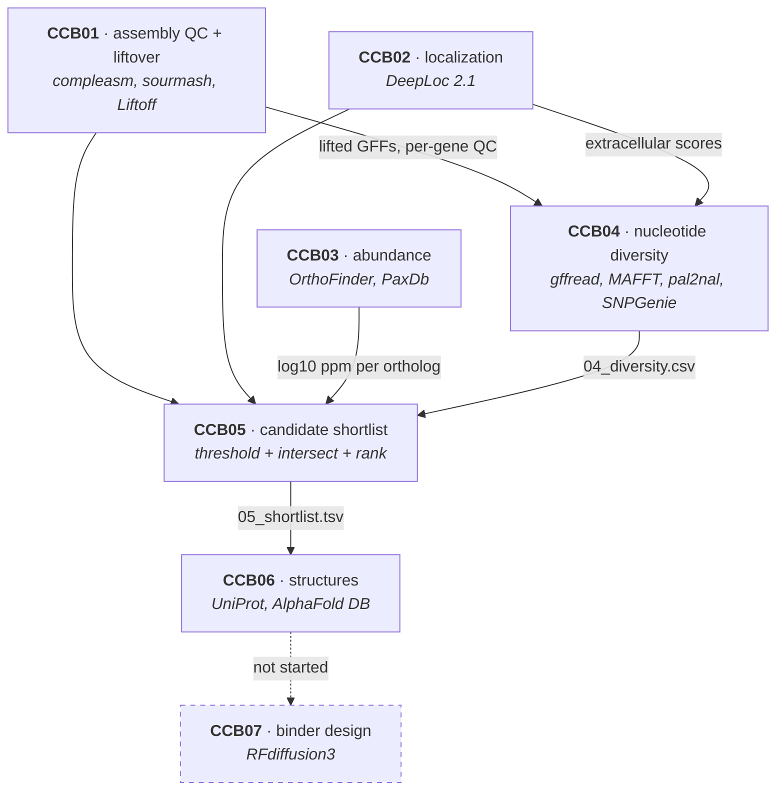

# CCayBinder

**De novo protein binders for a *Cyclospora cayetanensis* rapid antigen test.**

Screening the *C. cayetanensis* proteome for a target that a lateral flow assay can actually detect, then designing binders against it.

> [!WARNING]
> **Work in progress.** Target discovery is complete through the shortlist. Binder design has not started. Notebooks are Colab-first and carry hardcoded paths. Nothing here is validated experimentally.

---

## Stack

| Stage | Tools |
| :-- | :-- |
| Assembly QC | [compleasm](https://github.com/huangnengCSU/compleasm), [sourmash](https://sourmash.readthedocs.io/), NCBI Datasets |
| Annotation transfer | [Liftoff](https://github.com/agshumate/Liftoff), [gffread](https://github.com/gpertea/gffread) |
| Localization | [DeepLoc 2.1](https://services.healthtech.dtu.dk/services/DeepLoc-2.1/) |
| Orthology & abundance | [OrthoFinder](https://orthofinder.github.io/OrthoFinder/), [PaxDb v6](https://pax-db.org/) |
| Alignment | [MAFFT](https://mafft.cbrc.jp/alignment/software/), [PAL2NAL](https://www.bork.embl.de/pal2nal/) |
| Nucleotide diversity | [SNPGenie](https://github.com/chasewnelson/SNPGenie) |
| Annotation | [InterProScan](https://www.ebi.ac.uk/interpro/) |
| Structures | [AlphaFold DB](https://alphafold.ebi.ac.uk/), [UniProt](https://www.uniprot.org/) |
| Binder design | [RFdiffusion3](https://github.com/RosettaCommons/RFdiffusion) *(planned)* |
| Glue | Python, pandas, Biopython, Jupyter/Colab |

---

## Why

The 2026 US cyclosporiasis outbreak hit ~13,000 cases across 21 states, traced to iceberg lettuce. Detection today needs targeted sequencing, and three things make that hard:

1. Oocysts occur in very small numbers in food samples.
2. *C. cayetanensis* only grows in the human gut, so the signal cannot be amplified in culture.
3. The oocyst wall is tough, so DNA is hard to reach.

A protein binder for a lateral flow assay would be cheap to produce, stable at room temperature, and usable in a supply chain setting. Aptamer-based detection of oocyst wall proteins exists, but nucleotide aptamers are not practical at point of care.

---

## Target definition

A usable target sits at the intersection of three independent filters:

| Filter | Metric | Source |
| :-- | :-- | :-- |
| Conserved across strains | πN, πS, πN/πS | SNPGenie, across the assembly set |
| Surface-accessible | extracellular probability | DeepLoc 2.1 |
| Abundant enough to detect | log10 ppm | ortholog proxy from PaxDb |

None of the three is sufficient alone. An abundant, invariant, cytosolic protein is useless, because the antibody never reaches it. So each axis gets a hard threshold and the shortlist is the intersection, not a weighted score.

**Caveat on accessibility.** Most non-oocyst-wall proteins tagged for extracellular export go to the inner layer of the wall, so they are not exposed at the oocyst surface. The working assumption is that they become relatively more accessible after lysis with glass beads.

---

## Workflow



`CCB04` runs on a coarsely gated gene set, not the whole proteome. SNPGenie with 1000 bootstraps is the slowest step in the project, so whole-proteome diversity is not affordable. The gate in `CCB04` is deliberately looser than the final thresholds in `CCB05`, so thresholds can be tightened later without a re-run.

---

## Notebook spec

| Notebook | Reads | Writes | Does |
| :-- | :-- | :-- | :-- |
| `CCB01_genomes` | NCBI assemblies, CcayRef3 | `lift_per_gene.csv`, `lift_per_genome.csv`, lifted GFFs | Filters on completeness, drops duplicate and suppressed records, clusters by ANI, lifts the reference annotation onto every assembly |
| `CCB02_localization` | CcayRef3 `protein.faa` | DeepLoc results CSV | Predicts subcellular localization per protein |
| `CCB03_abundance` | reference proteomes, PaxDb datasets | `ccay_abundance.tsv` | Builds orthogroups against *T. gondii*, *P. yoelii*, *P. falciparum*; attaches PaxDb abundances per ortholog |
| `CCB04_diversity` | lifted GFFs, genomes, CCB01–02 outputs | `04_diversity.csv`, per-gene alignments, drop log | Gates the input set, extracts CDS per assembly, codon-aligns, measures πN/πS |
| `CCB05_shortlist` | CCB01–04 outputs | `05_metrics.tsv`, `05_shortlist.tsv` | Converts orthologs to one abundance per protein, joins all metrics, thresholds each axis, intersects, ranks |
| `CCB06_structures` | `05_shortlist.tsv` | structure table | Maps to UniProt, pulls AlphaFold models and pLDDT |

### Identifier bridge

The upstream outputs use three different keys. The reference GFF carries all three, and both `CCB04` and `CCB05` rebuild the mapping:

```
lift_per_gene.csv        DeepLoc CSV         04_diversity.csv
  gene-LOC......   <->    XP_........   <->    XM_........
```

### Abundance estimation protocol

There is no experimental expression data for *C. cayetanensis*, so abundance is borrowed from the closest relative that has it. Preference order: `tgon` → `pyoe` → `pfal`.

| Tier | Scenario (CCay : ortholog) | Action |
| :-- | :-- | :-- |
| 1 | 1:1 | **Exact** — copy the ortholog value |
| 2a | 1:many | **Median** — median of the ortholog abundances |
| 2b | many:1 | **Divide** — split the value between the CCay proteins |
| 3 | many:many | **Pooled divide** — sum the pool, divide between the group |
| 4 | too much missing data | **Inconclusive** — no value, or <80% coverage with <3 measured orthologs |

`log10_ppm` is a coarse rank, not a measurement. The value comes from a different species, in a different life stage, measured by a different lab. This is the weakest axis in the pipeline.

### Thresholds

Set in one config cell per notebook.

| Axis | Current value |
| :-- | :-- |
| Extracellular probability | ≥ 0.70 |
| Liftover usable rate | ≥ 0.90 |
| Abundance (log10 ppm) | ≥ 1.0 |
| Selection | πN/πS < 1.0 |
| Absolute diversity | πN ≤ 0.01 (used when πN/πS is undefined) |
| Alignment depth | ≥ 20 assemblies |

**On πS = 0.** Genes with no synonymous variation have an undefined πN/πS, and filtering by `πN/πS < 1` drops them despite those genes being the most conserved in the set. `CCB04` classes each gene as `invariant`, `synonymous_only`, `no_synonymous` or `ratio`, and `CCB05` handles the first two explicitly.

---

## Results so far

- 43 of 47 deposited assemblies pass 90% completeness. All are closely related (every assembly joins below 0.004 on 1 − ANI), with some clustering by collection year.
- Intersecting extracellular proteins with abundance estimates gave 63 candidates.
- Filtering on log10 ppm > 1 and πN/πS < 1 gave 9. Functional predictions come from InterProScan domains.

| # | Gene | Protein / function |
| :-- | :-- | :-- |
| 1 | LOC34622212 | uncharacterized, MACPF domain profile |
| 2 | LOC34621387 | uncharacterized, Venus flytrap-like |
| 3 | LOC34624131 | sporozoite developmental protein |
| 4 | LOC34619802 | uncharacterized, S1/P1 nuclease |
| 5 | LOC34617317 | uncharacterized, peptidase activity |
| 6 | LOC34621487 | proteasome subunit beta type-2-A |
| 7 | LOC34617670 | 3-ketoacyl-CoA thiolase |
| 8 | LOC34619099 | uncharacterized, predicted peptidase M16 |
| 9 | LOC34624017 | uncharacterized |

> These 9 come from the pre-consolidation notebooks. `CCB05` recomputes the shortlist from scratch with the πS = 0 handling and the depth filter, so the count will change.

---

## Binder design criteria

Targets for `CCB07`, once a target is chosen.

| Criterion | Detail |
| :-- | :-- |
| Sub-nanomolar affinity | High k_on, low k_off. Needed for low oocyst concentrations and a fast read |
| Epitope selectivity | No cross-reactivity with other foodborne parasites |
| Orthogonal sandwich pairing | Two binders, non-competing epitopes |
| Room temperature stability | Salt bridges over disulphides, rigid fold, low surface hydrophobicity |
| Reversible two-state unfolding | Refolds on contact with the analyte solution |
| High microbial expression | Codon optimality, stable GC, no mRNA hairpins, N-end stability |
| Surface immobilization | Binds nitrocellulose with the paratope facing out |

---

## TODO

**Pipeline**
- [x] Re-run `CCB04` and `CCB05` end-to-end on the consolidated notebooks
- [x] Tune `PIN_MAX` and `MIN_ALIGNED` against the observed distributions
- [ ] Move session-local paths (DeepLoc CSV, reference GFF) to persistent storage
- [ ] Add an `environment.yml` and pin tool versions

**Targets**
- [ ] Write up the 25 candidates (domain architecture, life-cycle stage, literature)
- [ ] Check which candidates are oocyst wall proteins vs inner-layer export
- [ ] Cross-check against the *Cyclospora* markers already used in qPCR panels
- [ ] Epitope-level triage, looking at surface accessibility and disorder on AlphaFold/deposited models
- [ ] Pick one primary target plus one backup

**Binder design**
- [ ] Design binders against the chosen epitope
- [ ] Filter on predicted affinity and expression
- [ ] Find an orthogonal pair for the sandwich format

**Known gaps**
- [ ] Abundance is a cross-species proxy, not CCay oocyst data
- [ ] DeepLoc gives localization, not surface accessibility on an intact wall
- [ ] The assembly set skews USA and Nepal, so πN is a lower bound on true diversity
- [ ] CcayRef3 gene models are ab initio (Gnomon) predictions

---

## Repository layout (TODO)

```
CCayBinder/
├── notebooks/
│   ├── CCB01_genomes.ipynb
│   ├── CCB02_localization.ipynb
│   ├── CCB03_abundance.ipynb
│   ├── CCB04_diversity.ipynb
│   ├── CCB05_shortlist.ipynb
│   └── CCB06_structures.ipynb
├── data/
│   ├── reference/          # CcayRef3 genome, GFF, proteome
│   ├── genomes/            # assembly working set
│   └── liftoff/            # lifted annotations, one GFF per assembly
├── results/
│   ├── 04_diversity.csv
│   ├── 05_metrics.tsv
│   └── 05_shortlist.tsv
└── README.md
```

---

## References

- Write-up: [Computational Design of a de novo Protein to Detect *Cyclospora cayetanensis*](https://murto.co/cyclospora-rat-binders/)
- CDC, [2026 cyclosporiasis outbreak](https://www.cdc.gov/cyclosporiasis/outbreaks/07-26/index.html)
- Shumate A, Salzberg SL. Liftoff: accurate mapping of gene annotations. *Bioinformatics*. 2021;37(12):1639-1643.
- Ødum MT, et al. DeepLoc 2.1: multi-label membrane protein type prediction using protein language models. *Nucleic Acids Res*. 2024;52(W1):W215-W220.
- Emms DM, et al. OrthoFinder: scalable phylogenetic orthology inference for comparative genomics. *bioRxiv*. 2025.
- Huang Q, et al. PaxDb v6.0: reprocessed, LLM-selected, curated protein abundance data across organisms. *Nucleic Acids Res*. 2026.
- Suyama M, Torrents D, Bork P. PAL2NAL: robust conversion of protein sequence alignments into the corresponding codon alignments. *Nucleic Acids Res*. 2006;34:W609-W612.
- Nelson CW, Moncla LH, Hughes AL. SNPGenie: estimating evolutionary parameters to detect natural selection using pooled next-generation sequencing data. *Bioinformatics*. 2015;31(22):3709-3711.
- Nei M, Gojobori T. Simple methods for estimating the numbers of synonymous and nonsynonymous nucleotide substitutions. *Mol Biol Evol*. 1986;3(5):418-426.
